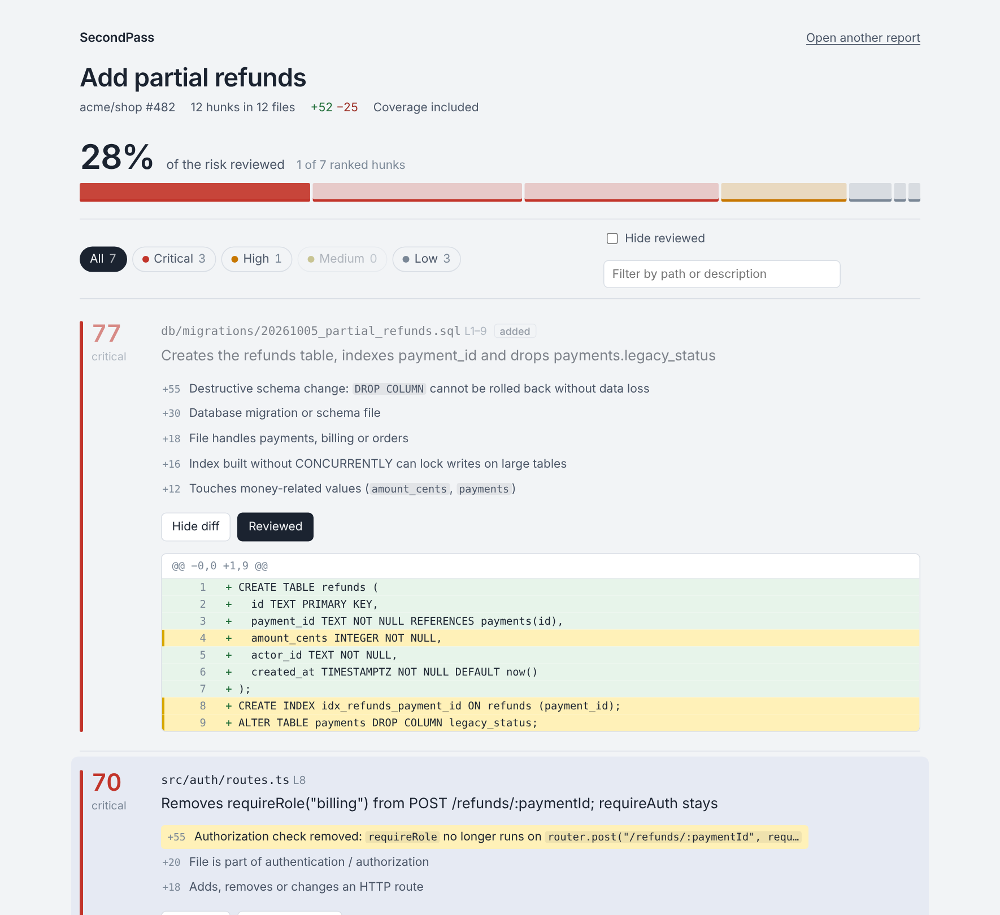

# SecondPass

**Make AI-written pull requests reviewable.** SecondPass ranks every hunk of a pull request by risk, so the reviewer reads the migration, the auth change and the money handling first, and the renames and reformatting are folded out of the way.

AI coding assistants changed what a pull request looks like. PRs are larger, every hunk is written with the same confidence, and reviewers respond by skimming. Skimming is fine for the 80% of a diff that is renames, import shuffles and formatter churn. It is how a dropped column or a removed permission check gets merged.



## What it does

- **Ranks each hunk** from the diff itself: destructive migrations, removed authorization checks, arithmetic on money, flipped boundaries (`>` → `>=`), un-awaited calls, swallowed errors, hard-coded secrets, and more. Every point of the score comes with a reason and the exact lines that triggered it.
- **Uses test coverage** on the touched lines. An untested change to billing ranks above a tested one. Severe changes are never discounted by coverage: a test executing a line proves it runs, not that it should.
- **Collapses the noise** — renames, formatting, reordered imports, comment edits, lockfiles and generated files — conservatively. Swapping `b` for an unrelated `c` is *not* a rename, and imports that move a name to a different module are *not* a reorder.
- **Keeps the model out of the verdict.** Claude writes a one-line description of what each hunk does. It never sees the score, its output can't change the order, and a description that drifts into judgement ("safely", "minor", "should") is thrown away. [Why](#why-the-model-doesnt-rank).
- **Shows up where review happens:** one sticky PR comment, the job summary, a self-contained HTML report with a review UI, and a CLI.

## Use it as a GitHub Action

```yaml
# .github/workflows/secondpass.yml
name: SecondPass
on: pull_request

permissions:
  contents: read
  pull-requests: write

jobs:
  review-order:
    runs-on: ubuntu-latest
    steps:
      - uses: actions/checkout@v4
      # Optional but recommended: produce coverage for the PR head first.
      - run: npm ci && npm test -- --coverage
      - uses: sarabudladeekshitha/secondpass@main
        with:
          coverage-file: coverage/lcov.info
          anthropic-api-key: ${{ secrets.ANTHROPIC_API_KEY }} # optional
```

The comment looks like this (from the [sample PR](examples/)):

> ### SecondPass · where to look first
> **12 hunks** in 12 files (+52 −25) · 🔴 3 critical · 🟠 1 high · 🟡 0 medium · ⚪ 3 low · 5 collapsed
>
> | Risk | Where | What it does | Why it's ranked here |
> |---|---|---|---|
> | 🔴 77 | `db/migrations/20261005_partial_refunds.sql` L1–9 | Creates the refunds table, indexes payment_id and drops payments.legacy_status | Destructive schema change: `DROP COLUMN` cannot be rolled back without data loss · Database migration or schema file |
> | 🔴 70 | `src/auth/routes.ts` L8 | Removes requireRole("billing") from POST /refunds/:paymentId; requireAuth stays | Authorization check removed: `requireRole` no longer runs on … · File is part of authentication / authorization |
> | 🔴 65 | `src/jobs/sync.ts` L4–12 | Raises ledger retries from 3 to 5, stops awaiting ledger.post and drops the final rethrow | `await` removed: the call is no longer waited for · Error is caught and ignored · 2 of 2 changed executable lines never run by tests |
> | 🟠 42 | `src/payments/refunds.ts` L6–25 | Adds an optional partial amount, tracks the remaining balance and now rejects refunds made exactly 30 days after capture (> becomes >=) | Arithmetic or rounding on money values … · Boundary changed: `>` → `>=` |
> | … | | | |
>
> ▸ 5 collapsed hunks: renames, formatting, imports, comments, generated files

Each location links to the exact line in the PR's *Files changed* tab. Re-runs update the same comment.

| Input | Default | |
|---|---|---|
| `github-token` | `${{ github.token }}` | Reads the diff, posts the comment. |
| `coverage-file` | | `lcov.info` or Cobertura XML (coverage.py, JaCoCo via converters). Comma- or newline-separated for monorepos. |
| `anthropic-api-key` | | Enables Claude descriptions. Without it, descriptions are derived from the diff. |
| `model` | `claude-haiku-5-5` | Model for descriptions. |
| `ignore` | | Newline-separated path regexes to skip. |
| `comment` | `true` | Post/update the PR comment. |
| `max-rows` | `25` | Ranked hunks listed in the comment. |
| `fail-on` | | `critical`, `high` or `medium`: fail the step at that tier. A prompt for a careful review, not a judgement on the code. |

Outputs: `report-json`, `report-html` (upload it with `actions/upload-artifact`), `critical`, `high`, `top-tier`.

On fork PRs, GitHub gives the workflow a read-only token; SecondPass then skips the comment and writes the ranking to the job summary instead. Very large PRs that GitHub refuses to render as one diff are rebuilt from the per-file patches API.

## Use it from the command line

Requires Node 22.18+.

```sh
git clone https://github.com/sarabudladeekshitha/secondpass && cd secondpass
npm install && npm run build

# In any repo:
node /path/to/secondpass/dist/cli.js --base origin/main --coverage coverage/lcov.info
git diff main...feature | node dist/cli.js --html review.html
node dist/cli.js --diff pr.diff --summaries --format markdown   # needs ANTHROPIC_API_KEY
```

```
CRITICAL  77  db/migrations/20261005_partial_refunds.sql:1-9
              · Destructive schema change: `DROP COLUMN` cannot be rolled back without data loss
CRITICAL  70  src/auth/routes.ts:8
              · Authorization check removed: `requireRole` no longer runs on `router.post(…`
CRITICAL  65  src/jobs/sync.ts:4-12
              · `await` removed: the call is no longer waited for
              · Error is caught and ignored
              · 2 of 2 changed executable lines never run by tests
...
5 collapsed:
  src/orders/service.ts:2  Rename only: `amt` → `totalCents`
  src/utils/format.ts:1    Whitespace, quotes or punctuation only
```

`--fail-on <tier>` exits with status 2, so it can gate a pre-push hook.

## The review view

`--html` (and the Action's `report-html` output) writes one self-contained file: no server, no network. Open [examples/sample-report.html](examples/sample-report.html) to try it.

- Hunks in risk order, each with its score and reasons. **Click a reason** to highlight the exact lines behind it; lines no test executes are marked in the gutter.
- The bar at the top measures **how much of the risk you've reviewed**, not how many files: each segment is as wide as its hunk's score. Reviewing the migration moves it further than reviewing the README.
- Keyboard: `j` / `k` to move, `o` to open the diff, `x` to mark reviewed. Reviewed state is kept per PR head in your browser.
- Works in light and dark mode and on a phone.

`npm run build` also produces `web/dist/`, a static viewer that opens any `report.json` (file picker, drag and drop, or `?report=<url>`).

## How ranking works

Each hunk is run through detectors that read only the diff. Each finding is a **signal** with a weight and a human-readable reason:

| Area | Examples (weight) |
|---|---|
| Schema & data | `DROP COLUMN` / `TRUNCATE` / `remove_column` (55) · `UPDATE`/`DELETE` without `WHERE` (45) · column rename or retype (32) · `NOT NULL` without default (30) · editing an already-applied migration (30) · non-concurrent index (16) |
| Auth | guard call removed — counted per call, so `requireAuth, requireRole(x), h` → `requireAuth, h` is caught even though the line was edited, not deleted (55) · session/permission logic changed (24) |
| Money | arithmetic or rounding on an *amount* — the last word of the identifier must be a money word, so `refundAmountCents` counts and `paymentId` doesn't, and the edit itself must touch the expression (32) · float conversion of money (14) |
| Behaviour | boundary `<` ↔ `<=` (26) · `&&` ↔ `\|\|` (26) · negation (24) · early return removed (22) · boolean flipped (20) · limit/timeout changed (18) |
| Errors & concurrency | `await` removed (26) · error swallowed (24) · error handling removed (20) · transactions, locks, retries (16) |
| Security | hard-coded secret (45) · TLS verification off (35) · SQL built by interpolation (32) · shell/eval (30) · unescaped HTML (26) |
| Surface | HTTP route changed (18) · exported symbol removed (16) · dependency versions (12) · CI/deploy config (14) |
| Tests | assertions removed (24) · `.skip` / `.only` (20) |

Scoring:

1. **Diminishing returns.** The strongest signal counts in full, the next half, the next a quarter. Ten small things don't outrank one dropped column.
2. **Coverage** scales the result from 0.8× (every changed executable line runs in tests) to 1.4× (none do). A file missing from the coverage report entirely gets 1.2×. Any signal of weight ≥ 50 blocks the discount.
3. **Context.** Test files count half unless they weaken the suite; documentation gets only a size signal.
4. **Tiers:** critical ≥ 65, high ≥ 40, medium ≥ 18, otherwise low.

The same diff and coverage always give the same order. The heuristics are regex- and token-based, so they are fast and explainable but not a type checker: expect some false positives, and treat the order as a reading plan, not a verdict.

## Why the model doesn't rank

The ranking has one job: make sure the reviewer looks at the right thing. That only works if the reviewer trusts it, and a reviewer who sees a tool be *confidently wrong* a couple of times stops reading it entirely. Language models are fluent at exactly that kind of wrong. (While writing the sample for this README, the first draft of a description said a `>` → `>=` change *allowed* refunds on day 30; it does the opposite.)

So the work is split:

- **Order** comes from deterministic rules over the diff and coverage. Every point is explained and points at lines you can check.
- **Description** — "what does this hunk do?" — is where a model genuinely helps, and where a mistake costs little because the diff is right there.

The boundary is enforced in code, not just in the prompt ([`src/summarize/summarize.ts`](src/summarize/summarize.ts)):

- Summaries are attached after ranking. The ranking is fingerprinted before and checked after; any difference throws.
- The summarizer receives only `{ id, path, section, diff }` — no scores, tiers or signals.
- Descriptions containing verdict or reassurance words ("safe", "minor", "just", "should", "no functional change", …) are discarded and replaced with a plain diff-based line.
- Collapsed hunks are never sent, and a failing API degrades to diff-based descriptions instead of failing the check.

The tests in [`test/rank.test.ts`](test/rank.test.ts) include a summarizer that tries to talk the reviewer out of reading a critical hunk; the order doesn't move and its words don't ship.

## Project layout

```
src/
  diff/parse.ts          unified-diff parser (git headers, renames, binaries, quoted paths)
  risk/signals.ts        detectors → weighted, explained signals
  risk/trivial.ts        conservative collapse rules
  risk/coverage.ts       lcov + Cobertura, CI-path matching
  risk/score.ts          diminishing returns, coverage, tiers
  analyze.ts             diff (+ coverage) → ranked report
  summarize/             Claude descriptions + the verdict guard
  report/                PR comment, terminal output, self-contained HTML
  action/                GitHub Action (fetch-based, no dependencies)
  cli.ts
web/src/                 React review UI
examples/                sample "partial refunds" PR, coverage and report
```

The CLI and Action have **no runtime dependencies**: GitHub and Anthropic are called with `fetch`, and the bundles in `dist/` include the viewer.

## Development

```sh
npm install
npm test          # node:test, runs the TypeScript directly
npm run typecheck
npm run build     # esbuild → dist/cli.js, dist/action.js, web/dist/, examples/sample-report.*
npm run demo
```

`dist/` is committed so the Action can run without an install step; rebuild it when you change `src/` or `web/`.

The sample PR in `examples/` was produced by real `git diff`. Its descriptions in `examples/sample-summaries.json` were written by hand to show the format a model produces, and go through the same verdict guard.

## License

MIT
